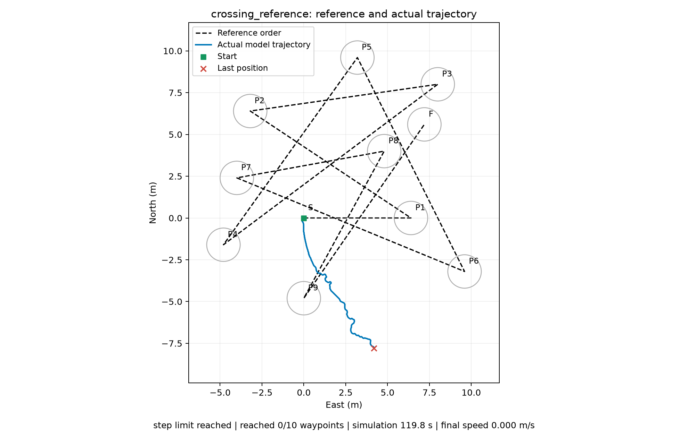
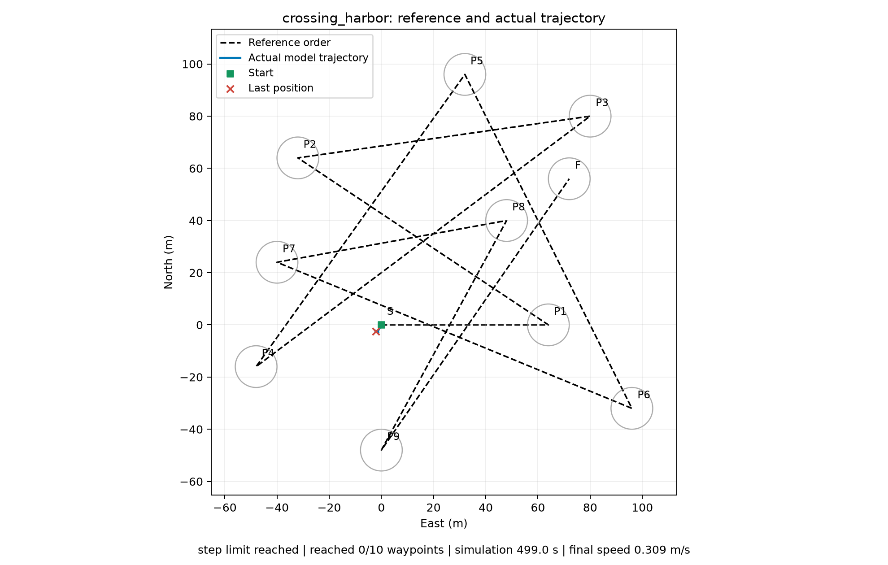

# 复杂交叉地图测试

按用户参考图估算航点坐标，新增 S → P1…P9 → F 共十个有序目标。黑色虚线表示访问顺序，不是必须贴合的路径。未复制图中 Jev 的实际轨迹，蓝线为本轮 Julia 真实推理所得轨迹。

地图参数独立位于 `../scenarios.json`，输出目录内保存每次运行时的地图副本。现有三个基础地图保持原值。模型策略、现场 IP 和端口未修改。

| 场景 | 到达圈半径 | 航点限速 | 候选速度上限 | 控制步长 | 决策步数 | 已按序到达 | 最后到当前目标距离 |
| --- | ---: | ---: | ---: | ---: | ---: | ---: | ---: |
| crossing_reference | 1 m | 1.2 节 | 3 节 | 0.2 s | 600 | 0 / 10 | 8.10 m |
| crossing_harbor | 8 m | 6 节 | 12 节 | 1 s | 500 | 0 / 10 | 66.16 m |

两次均未完成。参考尺度图是按截图近似重建，港区版是坐标十倍放大；不同尺度使用相应的限速和控制周期，不能仅用两次结果衡量地图尺度本身的影响。单次确定性测试不构成通用能力评估。即使实际轨迹经过其他航点圈，未按序经过的点也不计为到达。

## 参考图尺度

数据：[summary.json](julia-crossing-reference/summary.json)，[逐步决策](julia-crossing-reference/crossing_reference.jsonl)。模拟推进至 119.8 秒处的最后采样，最终停在目标圈外。平均完整决策 19.2 ms。

## 港区尺度

数据：[summary.json](julia-crossing-harbor/summary.json)，[逐步决策](julia-crossing-harbor/crossing_harbor.jsonl)。模拟推进至 499 秒处的最后采样，平均完整决策 43.0 ms。

执行命令与地图说明见 [部署文档](../../LOCAL_MODELS.md#复杂交叉地图)。运动模型和原有离线测试限制仍适用，以上不是实艇测试。
