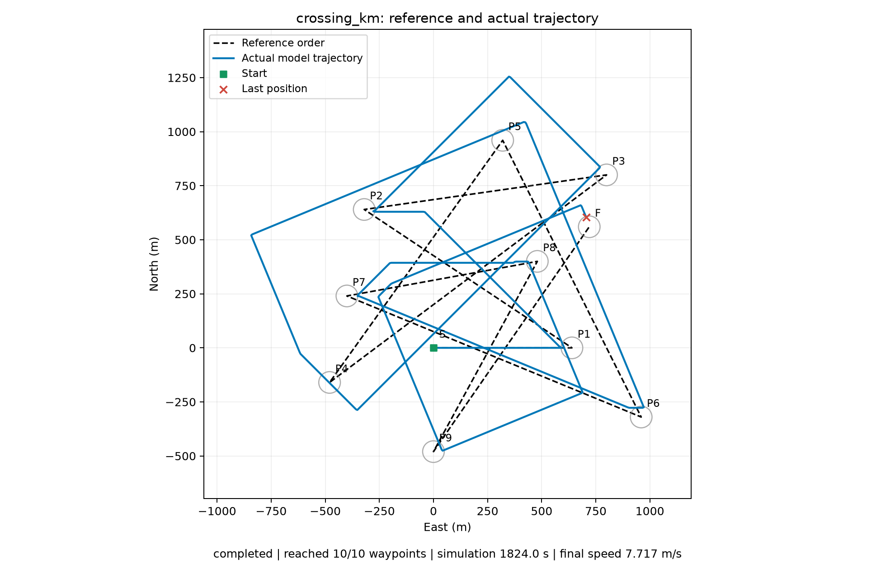

# Kev-4B 本地部署与实测结果

已部署 `jaredpalmer/kev-4b` 并在 RTX 5090 上真实推理。独立 `.venv-kev` 运行官方服务，原 `.venv` 运行模型无关的报文服务和仿真器；Julia与Jev后端保留。

## 候选与环境

固定目标航速15节，16个绝对航向，0°起每22.5°一项。北起顺时针，16选1，一次模型选择。没有生成文本、规则代选、候选筛除或模型失败后的随机补选。原始请求示例见 `../examples/kev_request.json`，实际逐步请求与响应见下方JSONL。

运行时代码 `1f04cfa28e6a708485b28a9585010b9e436b776e`，适配器版本 `6cfce5c2fa4b4bd64026336ab649c5ca78857d52`，基座版本 `1001bb4d826a52d1f399e183466143f4da7b741b`。原始head SHA-256 `dd633435998ecc751ac538717a3742e32149500fabf7d7276287dbf0693f347c`；adapter SHA-256 `90e817356246e7f18bfa7ca3d31794cd4fbeb3332a66a84cb51d9ceae925f2b2`，与发布记录一致。离线部署副本只重定向基座路径，全部数值权重与原发布文件逐项相等。

Python3.12.3、PyTorch2.8.0+cu128、Transformers5.20.2、PEFT0.21.2，官方bf16标准CUDA路径；未启用可选融合内核、CUDA graphs或前缀缓存。模型加载后显存约9.5GB。完整依赖及服务模型元数据见 `kev-crossing-km/environment.json`、`service-models.json` 和 `../../local_models/requirements-kev-tested.txt`。

## 公里级完整航线

地图 `crossing_km`，实际航点跨度1440×1440米，S→P1…P9→F共十个有序目标，到达圈半径50米，航点通过限速20节，控制步长1秒。

| 指标 | 实测 |
| --- | ---: |
| 按序到达 | **10 / 10** |
| 决策次数 | 1825 |
| 最后采样仿真时间 | 1824秒（30分24秒） |
| 距终点中心 | 47.19米，进入50米圈 |
| 最终目标航速 | 15节 |
| 平均完整决策 | 217.3毫秒 |
| P95 | 218.7毫秒 |
| 最大完整决策 | 1539.0毫秒（1次超过1秒） |
| 测试总墙钟时间 | 397.6秒 |
| 每秒位置采样弦长累计 | 14.05公里 |
| 相邻指令180°反向次数 | 1次 |

核对全部1825步：目标航速均为15节，每步16个候选，所有输出均属于22.5°间隔的航向集合；目标索引只按顺序推进，并核对每次推进时的实际位置已进入上一目标圈。`audit.json` 保存核对统计。0次采样超速在本轮固定15节/限速20节下是预期结果，不是实艇安全认证。

完成判据为**按序进入最终航点圈**，不是停车；最终仍以15节运动，符合本轮不考虑停车的设定。路径存在明显绕行，参考折线总长约11.97公里，实际轨迹不是最优路线。与历史Julia相比同时改变了模型、速度/航向候选、提示词与上下文组织，不能将差异全部归因于模型本身。

数据：[汇总](kev-crossing-km/summary.json)、[逐步输入与模型响应](kev-crossing-km/crossing_km.jsonl)、[核对统计](kev-crossing-km/audit.json)、[航速与耗时图](kev-crossing-km/crossing_km.png)。

## 真实 localhost UDP

额外启动真实UDP服务子进程，通过Kev本机HTTP模型交换实际任务/态势/控制/状态报文；15秒运动阶段后发送停止请求，模拟艇实际降速后返回 `status=2, description=stopped`。

收到19条控制、20条状态，确认有非零航速指令，停止完成。该短测的任务/控制/状态端口分别为 `127.0.0.1:33444`、`:34204`、`:55576`，每轮自动分配。数据见 `kev-udp/summary.json`、`udp-controls.json`、`udp-statuses.json` 和 `udp-service.log`。此处stopped表示显式停车请求完成，不代表短测已完成整条航线。

## 验证与限制

25项服务回归与模型契约测试通过；两个独立环境的pip check通过。原官方Kev运行时代码未修改。原现场IP/端口未修改，新增加的模型服务只监听本机 `127.0.0.1:18028`。

公里级航线使用理想化地速响应，推理时暂停仿真世界；没有真实船体、风流、障碍与执行器进度模型。此结果是单地图单次真实模型验证，未覆盖扰动、不同初态和失效场景，不代表实艇已完成验证。标准CUDA路径有一次请求超过1秒，需要关注实际控制周期内的尾延迟。

启动、复现和配置说明见 [KEV.md](../../KEV.md)。
