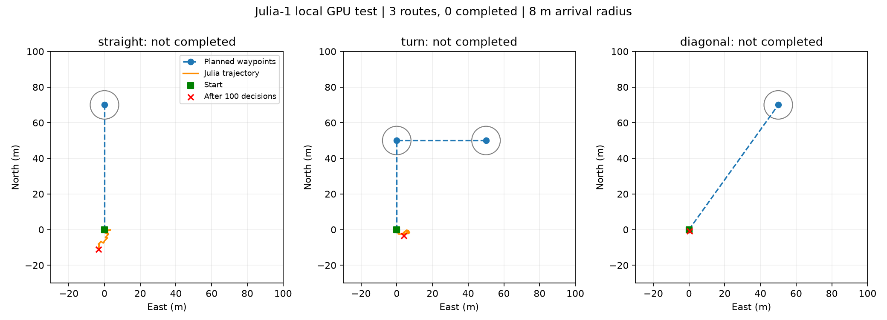

# Julia-1 本地部署与验证结果（2026-10-22）

Julia-1 已在本机部署成功，CPU / RTX 5090 均能真实推理，无 Jev API 调用。当前分组候选适配在三条简单航线上全部失败，不建议直接用于实际航行控制。

## 实验设置

固定模型：`SupersonicLabs/Julia-1@a85b127321d580d65176c89ced8273f305745d85`，权重 SHA-256 已与官方 provenance 核对。Python 3.12.3、PyTorch 2.14.1+cu130、Transformers 5.0.0，CPU 4 线程。完整记录见 `environment.json`，依赖见 `../../local_models/requirements-tested.txt`。

任务为民用航路点跟踪，输入仅本艇运动信息和航路点。未使用敌我属性、威胁等级。模型输入为当前位置到当前目标的运动事实摘要；与原 Jev 长提示不同，未包含完整后续航点预览。保持全部 64 个候选，四组 16 项先选、四个胜者复选；不是原生一次性 64 选一。每个候选实测 32–35 token，启用严格无截断编码。

每步控制时长 1 秒，模拟航路点限速 6 节、半径 8 米，最大候选速度 12 节（现场默认仍保留 30 节）。加速仿真每次推理后推进一秒，推理时暂停世界。运行时没有规则控制器或随机动作替模型代选。

## 真实模型闭环结果

| 环境 / 场景 | 步数 | 初始当前目标距离 | 最后当前目标距离 | 是否完成 | 平均完整决策耗时 |
| --- | ---: | ---: | ---: | --- | ---: |
| CPU / 直线 | 60 | 70 m | 75.37 m | 否 | 1.292 s |
| GPU / 直线 | 100 | 70 m | 81.19 m | 否 | 45.3 ms |
| GPU / 转弯 | 100 | 50 m | 53.50 m | 否，未通过首个目标点 | 43.7 ms |
| GPU / 斜向 | 100 | 86.02 m | 86.41 m | 否 | 42.6 ms |

CPU P95 1.325 秒，超过现有 1 秒控制周期。GPU 首次决策 222 ms（含首次执行开销），其余约 43–45 ms。耗时包含观测整理、候选预测、两轮模型选择和报文编码；UDP 服务日志另记录模型选择耗时。每个环境只执行一轮场景测试，不能视为统计稳定性结论。

三条 GPU 航线均未进入目标圈；采样超速计数为 0 不代表已验证入圈限速或成功停车。CPU/GPU 使用不同精度及官方运行时不同的决策头优化，动作可能不完全相同。

逐步输入、64 个候选描述、四个胜者、最终动作、最终题概率及耗时见 `julia-cuda/*.jsonl`；各场景有单独轨迹/航速/耗时图。CPU 记录见 `julia-cpu/`。这些结果说明当前适配无法可靠跟踪航路点，不证明 Julia 在其他任务或其他输入组织方式下一概不可用。数值比较、分组淘汰和提示组织均可能影响结果，本轮未对失败原因做受控消融，也未改变控制器以掩盖失败。

## 真实 UDP 集成

CPU 上启动实际服务子进程，使用真实 localhost UDP 交换任务 `0x0660`、持续态势 `0x0060`、控制 `0x0662`、执行状态 `0x0664` 和停止 `0x0666`。

- 12 秒运动阶段后发出停止；收到 16 条控制报文、17 条状态报文。
- 收到过非零航速控制。
- 模拟艇实际降速后，最终状态为 `status=2`、`description=stopped`。
- 停止时剩余航点仍为 1，剩余距离约 69.33 m；这是停止请求完成，不是航线完成。
- 本次临时地址：任务 `127.0.0.1:36245`，控制 `127.0.0.1:54829`，状态 `127.0.0.1:60274`。后续执行随机分配端口，以各次 `summary.json` 为准。

原始记录：`julia-udp-cpu/summary.json`、`udp-service.log`、`udp-statuses.json`、`udp-controls.json`。

## 检查与限制

服务回归与新后端测试共 19 项通过，`pip check` 通过。原导航测试 17 项中 9 项因当前仓库缺失 Unity 的 `Assets/StreamingAssets/fixed_route.json` 等资源而报错，未补造这些资源。

GPU 首次执行因 PyTorch 2.14 的可选原生 JIT 内核需要 `Python.h` 而失败；后端在导入 PyTorch 前默认设置其官方开关 `TORCH_DISABLE_NATIVE_JIT=1`，使用标准 CUDA 运算，未修改系统或第三方源码。显式设置此变量为 0 可覆盖默认，但相应主机须具备开发头文件。

模拟使用现有近似地速预测器，预测与模拟共享简化动力学，没有风流、障碍或真实执行器状态。加速仿真不验证实时运动；UDP 测试仅验证通信与停止流程。未连接甲方服务、未部署到用户尚未提供的实机、未向现场 IP 发送数据。

原现场 IP/端口未改。原源码动力目标 `192.168.3.201:18123`，原环境示例和 Compose 为 `192.168.3.126:18123`，存在既有差异；详细恢复与启动记录见 `../../LOCAL_MODELS.md`。
