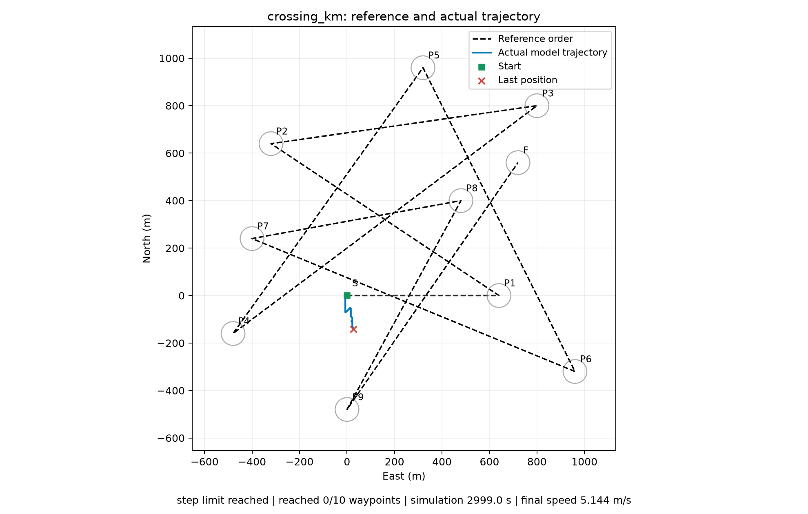

# 公里级交叉地图实测

地图真实航点跨度 1440×1440 米，坐标范围东西/南北均为 -480～960 米。沿用参考图的十个有序目标，航点半径50米、通过限速20节；Julia固定10/20节，共16选项，一次选择。

GPU实测3000步、每步1秒，按序到达0/10，最后距首个目标629.24米；完整决策平均12.3ms。地图尺寸与速度约束已匹配，但当前提示词/选择适配仍未可靠完成航点跟踪。不能将之前失败仅归因于地图过小。

19项服务回归测试通过。未改模型提示词、原地图或现场IP/端口；仿真原有停车完成判据仍保留，本轮连首个目标尚未到达，故不影响本轮未到点判断。

运行命令见仓库 `server/LOCAL_MODELS.md` 的公里级地图章节。`summary.json` 保存汇总；`crossing_km.jsonl` 保存逐步提示词、选项、选择及轨迹；`scenarios.json` 保存地图参数。
